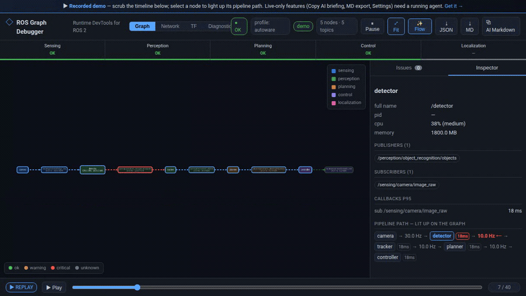
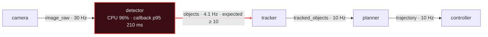
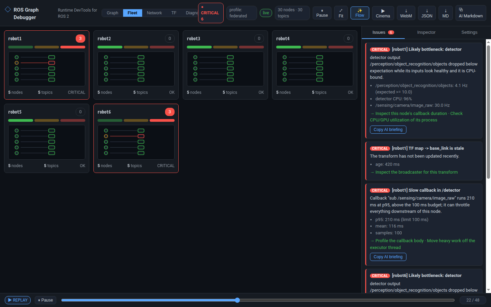

# ROS Graph Debugger

[](https://github.com/rsasaki0109/ros_graph_debugger/actions/workflows/ci.yml)
[](https://docs.ros.org)
[](LICENSE)
[](https://rsasaki0109.github.io/ros_graph_debugger/)

<p align="center">
  <a href="https://rsasaki0109.github.io/ros_graph_debugger/">
    
  </a>
  <br/>
  <em>Data flows along the graph; then the detector stalls — its node turns red, readiness goes ERROR, and its pipeline path lights up the rate <b>and</b> callback bottleneck. <a href="https://rsasaki0109.github.io/ros_graph_debugger/">Try it live →</a></em>
</p>

**Runtime DevTools for ROS 2.** A live, AI-friendly view of your running ROS 2
system: the graph, topic rate / bandwidth / message size, QoS, TF freshness,
diagnostics — and an issue panel that tells you *where to look next*.

Not a replacement for `rqt_graph`. It overlays runtime metrics and bottleneck
detection on the graph, and exposes everything as a web view, JSON, Markdown,
and an MCP server so AI assistants can debug your robot with you.

> Works with **Autoware** and **Nav2** via profile packs. Built for **ROS 2
> Jazzy / Humble** on Ubuntu 24.04 / 22.04.

> 🌐 **Try it in your browser — no install:**
> **[rsasaki0109.github.io/ros_graph_debugger](https://rsasaki0109.github.io/ros_graph_debugger/)**
> — the real web UI playing the scripted bottleneck demo, fully client-side.
>
> 🎬 **Or run it locally:** `ros2 run ros_graph_debugger rgd serve --demo`
> — the same scripted pipeline with a transient bottleneck, in the real web UI.

The `--demo` pipeline at the moment it stalls — the detector's **210 ms
callback** throttles `/objects` to **4.1 Hz**, and the tool flags it as one
issue with evidence:



> The whole-system view, the focused pipeline path, and the issue evidence are
> in [docs/example_briefing.md](docs/example_briefing.md) — exactly what an AI sees.

---

## 60-second quick start

```bash
# build
cd ~/your_ws && colcon build --packages-select ros_graph_debugger
source install/setup.bash

# run the agent (opens http://localhost:3939)
ros2 run ros_graph_debugger agent

# in another terminal, run the demo pipeline
ros2 run ros_graph_debugger demo_pipeline
```

### Other ways to install

```bash
# pip — the offline CLI (report / diff / assert / federate / MCP) + web replay.
# The live agent still needs ROS 2 (rclpy); use colcon or Docker for that.
pip install "ros_graph_debugger[web]"
rgd serve --demo

# Docker — the live agent, joining the host's DDS graph
docker run --rm --net=host --pid=host ghcr.io/rsasaki0109/ros_graph_debugger
docker run --rm --net=host --pid=host ghcr.io/rsasaki0109/ros_graph_debugger:humble --profile nav2
```

Match `ROS_DOMAIN_ID` / `RMW_IMPLEMENTATION` to your robot with `-e`.
`--pid=host` lets the agent map nodes to processes for CPU / memory.

### See it instantly — no robot, no ROS graph required

```bash
ros2 run ros_graph_debugger rgd serve --demo     # → http://localhost:3939
ros2 run ros_graph_debugger rgd serve --demo --cinema
ros2 run ros_graph_debugger rgd serve --demo --fleet 6
```

Replays a scripted `camera → detector → … → controller` session in the real web
UI: the detector stalls in the middle, its output topic and node turn red, the
bottleneck issue appears, and `map → base_link` goes stale — then recovers. Use
the timeline at the bottom to scrub through it. This needs no DDS, so it's the
fastest way to try the tool (and to record a demo GIF). Replay any captured
session the same way: `rgd serve run.rgd.json`.

`--fleet N` multiplexes the built-in demo into `robot1..robotN` with phase
offsets and opens the Fleet wall: per-robot health tiles, issue badges, mini
graph thumbnails, and click-through drill-down to one robot's full graph.

<p align="center">
  
</p>

`--cinema` opens Incident Theater: the replay starts from a wide view, zooms to
the first critical issue, slows the timeline, captions the evidence, lights the
pipeline path, then pulls back on recovery. In the UI, use **Export WebM** to
record one pass in the browser. Convert it to a shareable GIF with:

```bash
ffmpeg -i ros-graph-incident-theater.webm -vf "fps=12,scale=900:-1:flags=lanczos" docs/img/demo.gif
```

---

Open <http://localhost:3939>. With a live system you'll see:

```
camera → /sensing/camera/image_raw → detector → /perception/.../objects → tracker → planner → controller
```

The detector periodically enters a "slow" phase. Watch its output topic turn
**red**, the node turn red, and an issue appear:

> **[CRITICAL] Likely bottleneck: detector**
> detector output /perception/object_recognition/objects dropped below
> expectation while its inputs look healthy and it is CPU-bound.
> - Evidence: /perception/object_recognition/objects: 4.4 Hz (expected >= 10.0);
>   detector CPU: 95%; /sensing/camera/image_raw: 30.0 Hz

Run with the Autoware profile to get expectations and pipeline grouping:

```bash
ros2 run ros_graph_debugger agent --profile autoware
```

---

## Why

ROS 2 debugging is fragmented across `rqt_graph`, `ros2 topic hz`,
`ros2 topic bw`, `ros2 topic echo`, `ros2 doctor`, TF tools, `/diagnostics`,
and `htop`. Finding "why is my pipeline slow" means bouncing between all of them.

ROS Graph Debugger puts graph, metrics, QoS, TF, diagnostics, and bottleneck
detection into one live view — and one Markdown briefing you can hand to an AI.

## Features

- **Live ROS graph** with auto layout (pub → topic → sub) and **animated data
  flow** — dashes march along each edge at a speed set by the topic's rate, and
  bottleneck nodes pulse a red halo (toggle with **✨ Flow**). Plus a **Network
  view** — a sortable/filterable table of every topic (rate, bandwidth, p95
  size, QoS, status), like a Chrome DevTools Network tab for ROS — and
  dedicated **TF tree** and **Diagnostics** views.
- **Topic metrics**: rate, bandwidth, avg / p95 message size (opt-in probing).
- **QoS mismatch detection** — the classic "connected but no data flows" trap,
  across every request/offer policy DDS checks: reliability, durability,
  deadline, liveliness kind and lease duration. The issue names the failing
  pair and policy (e.g. `/lidar → /fusion: deadline: publisher offers 200 ms,
  subscriber requests 100 ms`) — the same thing rmw's incompatible-QoS events
  report, found from the graph alone.
- **Message latency (Tier A)** — `header.stamp` age (p50/p95) on probed topics,
  with a freshness issue when it exceeds a profile's `max_age_ms` (e.g. stale
  localization). Cheap approximation now; tracing-based tiers below.
- **Topic statistics (Tier B)** — reads rclcpp topic statistics
  (`statistics_msgs/MetricsMessage` on `/statistics`) and turns each
  subscriber's message period / age into a rate and age for topics the agent
  does **not** probe — e.g. the camera and LiDAR topics it never subscribes to.
  The message names a node, not a topic, so attribution is explicit: a node
  with one data subscription is matched automatically; for others map the
  stats topic yourself (`agent --statistics-topic /stats/image=/camera/image_raw`).
  Marked `stats` in the UI and briefing; unattributed stats are listed, not
  guessed.
- **Reported processing time (Tier B)** — nodes that publish their own
  per-cycle processing time (Autoware's `~/debug/processing_time_ms`, enabled
  by `--profile autoware`; any topic via `--processing-time-topic REGEX`)
  count as that node's execution time without tracing: checked against the
  stage budgets (`slow_callback`), shown on the pipeline path, and read from
  bags by `rgd bag analyze` too.
- **Callback execution time (Tier C)** — per-callback p95/mean/max duration, a
  `slow_callback` issue when a callback blows its budget, and the stat surfaced
  in the node Inspector and AI briefing. Budgets are **stage-aware** — the
  Autoware/Nav2 profiles give control callbacks a tight (~10–15 ms) budget and
  planning a looser one, so the same 60 ms is fine for a planner but a violation
  for a controller. Feed **real** traces turn-key: record with `ros2 trace`,
  then `agent --trace-file ~/.ros/tracing/<session>` (or convert once with
  `rgd trace convert <session> --out run.ndjson`). Each callback is resolved to
  its node and topic from the trace's own registration events (subscriptions,
  timers, services; needs `python3-bt2`); the `--demo` shows it synthetically.
  See [docs/tracing.md](docs/tracing.md).
- **Lifecycle (managed) nodes** — every node serving `<node>/get_state` has
  its state read with a non-blocking `GetState` query, so a Nav2 node stuck in
  `inactive` / `unconfigured` stops being invisible: its graph node is dashed
  with the state shown, and a `lifecycle_not_active` issue names the exact
  `ros2 lifecycle set … activate` command — **critical** when its outputs have
  subscribers waiting (the classic "nothing on `/cmd_vel`"). `--no-lifecycle`
  turns the queries off.
- **Services & actions** — who serves and who calls each service and action
  (an action is found by its `<action>/_action/send_goal` service), in the
  node Inspector and the snapshot. A client with no server anywhere — e.g.
  `bt_navigator` calling `follow_path` with no controller up — raises a
  `no_action_server` / `no_service_server` issue; parameter services are left
  out.
- **Node CPU / memory**, with honest node→process mapping confidence: layered
  matching (`__node:=` remap → `high`, executable name → `medium`, bare token →
  `low`) and component containers capped at `low` since per-node CPU can't be
  split.
- **TF freshness** — stale transform detection, plus a **TF tree view** that
  renders the live `/tf` forest (parent → child) with per-edge age and
  static/dynamic badges.
- **/diagnostics** ingestion (WARN / ERROR become issues), plus a
  **Diagnostics view** — every status grouped worst-first with level, message,
  and hardware id.
- **System health verdict**: a one-line rollup — `OK` / `DEGRADED` / `CRITICAL`
  with the top issue — in the web header chip, at the top of the AI briefing,
  and at `GET /api/v1/summary`. The bottom line, first.
- **Issue panel**: each issue has a plain-English explanation, evidence, and
  suggested actions, ranked by severity — and selecting a node or topic lists
  the issues touching it right in the Inspector, one click from the full panel.
- **Pipeline path** — trace the constraining source→sink route through any node
  or topic (it follows the lowest-rate link at each branch), so a bottleneck
  reads as `camera → … → detector → /objects (4.1 Hz ⟵ slowest) → tracker → …`.
  Selecting a node **lights the path up on the graph** (constraining hop in
  red); also in the node Inspector, the focused AI briefing, and
  `GET /api/v1/path`. Each hop also carries the consuming node's **callback
  p95**, so the path shows the rate bottleneck *and* the execution bottleneck
  together (`detector [cb 210 ms ⟵ slowest cb] → /objects (4.1 Hz ⟵ slowest)`).
- **Profiles**: `autoware`, `nav2`, `moveit` (grouping + expected rates, incl.
  regex patterns like `^/control/command/.*` that set a floor for a whole stage).
- **Live tuning**: a Settings tab (and `POST /api/v1/config`) to adjust expected
  rates and thresholds at runtime — no restart, the issue engine picks it up.
- **Terminal top view**: `rgd top` gives an SSH-friendly dashboard with
  readiness, node/topic rows, rate sparklines, CPU/callback p95, and issues.
- **Fleet wall**: federation snapshots with multiple hosts show a Fleet tab of
  per-robot tiles. Critical hosts pulse red, and each tile drills into that
  host's full graph. Try it without DDS via `rgd serve --demo --fleet 6`.

## AI-friendly by design

> 📄 **See exactly what an AI sees:** [docs/example_briefing.md](docs/example_briefing.md)
> — the real briefing from `--demo` at the moment the detector stalls (bottleneck,
> stale TF, slow callback, and the focused pipeline path).

The whole runtime state is available in three machine-friendly ways:

| What | Endpoint | Use |
|---|---|---|
| Structured JSON | `GET /api/v1/snapshot` | programmatic access |
| **Markdown briefing** | `GET /api/v1/snapshot.md` | paste into an LLM / agent |
| **Focused briefing** | `GET /api/v1/snapshot.md?focus=TARGET` | just one node/topic + neighbours (also a "Copy AI briefing" button on every node Inspector **and issue card**) |
| **MCP server** | `python -m ros_graph_debugger.mcp_server` | let Claude query the live graph |

The web header also has one-click **⤓ JSON** / **⤓ MD** buttons to download the
current snapshot or briefing to a file (handy for attaching to a bug report or
handing to an AI offline).

```bash
# grab an AI-ready briefing from anywhere
curl http://localhost:3939/api/v1/snapshot.md

# or via the CLI
rgd markdown
```

Register the MCP server with Claude Code:

```bash
pip install "mcp[cli]"
claude mcp add ros-graph -- python -m ros_graph_debugger.mcp_server
```

Now an AI assistant can read the live robot — `get_runtime_snapshot`,
`get_runtime_briefing`,
`get_node_briefing(target)` (a focused briefing for one node or topic and its
neighbours — the right size for a large Autoware/Nav2 graph),
`get_pipeline_path(target)` (the constraining source→sink route, to reason about
*where* a pipeline is slow), `get_issues`, `get_graph`,
`get_topics`, `get_nodes`, `get_tf`, `get_diagnostics`, `get_callbacks`,
`get_config` — and
**act** on it: `set_expected_rate(topic, min_hz)` encodes what "healthy" looks
like for a topic at runtime, so the issue engine starts flagging it immediately.
No restart, no file editing.

Use `get_runtime_snapshot` when node/topic metrics, TF freshness and issue
evidence must be collected together. It returns the same complete JSON as
`rgd snapshot`, including the timestamp, issue kinds, mapping confidence and
unavailable metrics as `null`. The focused briefing and individual tools remain
useful when only a small part of a large graph is needed.
See the [evidence collection evaluation](docs/evidence-collection.md) for the
real ROS cases, reproducible protocol, tool-call comparison and its limits.

## Safety: probing is opt-in and bounded

The graph, QoS, TF, and diagnostics are collected **passively** (no data
subscriptions). Message-rate probing uses lightweight raw subscriptions and is
deliberately conservative:

- Large sensor topics (`Image`, `CompressedImage`, `PointCloud2`, `LaserScan`)
  are **never** probed automatically.
- At most `--max-probe-topics` (default 12) topics are probed.
- Narrow the scope explicitly with `--probe-topic`, `--probe-regex`,
  `--probe-large-topics`, or disable entirely with `--no-probe`.

```bash
ros2 run ros_graph_debugger agent \
  --probe-regex '^/perception/.*' --max-probe-topics 20
```

## CLI

```bash
ros2 run ros_graph_debugger agent [--profile autoware] [--port 3939] ...

# one-shot queries (rgd talks to a running agent over REST)
ros2 run ros_graph_debugger rgd snapshot --out snap.json
ros2 run ros_graph_debugger rgd markdown        # AI briefing to stdout
ros2 run ros_graph_debugger rgd issues          # list current issues
ros2 run ros_graph_debugger rgd doctor          # is the agent up?

# Tier C: turn a `ros2 trace` session into callback durations (needs python3-bt2)
ros2 run ros_graph_debugger rgd trace convert ~/.ros/tracing/my_session --out run.ndjson

# terminal dashboard (requires optional TUI extra)
pip install ros_graph_debugger[tui]
ros2 run ros_graph_debugger rgd top             # live agent from --base
ros2 run ros_graph_debugger rgd top --demo      # no DDS required
ros2 run ros_graph_debugger rgd top run.rgd.json

# fleet: merge several robots' agents into one AI briefing
ros2 run ros_graph_debugger rgd federate robot1=http://10.0.0.2:3939 robot2=http://10.0.0.3:3939

# ...or serve the merged fleet live in the web UI
ros2 run ros_graph_debugger rgd federate --serve robot1=http://10.0.0.2:3939 robot2=http://10.0.0.3:3939
```

### Record & report

Capture a window of runtime and turn it into a shareable report — ideal for bag
replay analysis and CI bottleneck checks (no live ROS needed to read it back):

```bash
# record 30s of snapshots (streams NDJSON to disk)
ros2 run ros_graph_debugger rgd record --out run.rgd.json --duration 30

# self-contained HTML report + AI-friendly Markdown
ros2 run ros_graph_debugger rgd report run.rgd.json --html report.html --md report.md

# or replay the captured session in the web UI with a time-scrubber
ros2 run ros_graph_debugger rgd serve run.rgd.json

# cinematic replay for screenshots / WebM export
ros2 run ros_graph_debugger rgd serve run.rgd.json --cinema

# turn a rosbag2 / MCAP bag into the same kind of recording (offline)
ros2 run ros_graph_debugger rgd bag analyze drive.mcap --out drive.rgd.json

# did the system meet its contract over the window? (exit 1 = failed)
ros2 run ros_graph_debugger rgd assert run.rgd.json --expect /objects=10

# did my change regress the pipeline? compare two recordings (exit 1 = regressed)
ros2 run ros_graph_debugger rgd diff before.rgd.json after.rgd.json --fail-on-regression

# render the same comparison as a before/after graph image
ros2 run ros_graph_debugger rgd diff before.rgd.json after.rgd.json --image diff.svg
```

`rgd diff` compares two recordings and reports what got **worse** — topic-rate
drops, slower callbacks, new issues, and a health-verdict change — as a Markdown
(or `--json`) regression briefing. With `--fail-on-regression` it exits non-zero,
so you can gate a CI job on "this change didn't slow the pipeline down." Add
`--image diff.svg` to render a side-by-side graph; use `--image diff.png` after
installing `ros_graph_debugger[image]` for optional PNG conversion.

### From a bag (offline, no live system)

Already have a rosbag2 bag from the robot, sim or CI? Turn it into the same
recording — then everything above works on it:

```bash
ros2 run ros_graph_debugger rgd bag analyze drive.mcap --out drive.rgd.json \
  --profile nav2 --expect /scan=8

ros2 run ros_graph_debugger rgd report drive.rgd.json --html report.html
ros2 run ros_graph_debugger rgd assert drive.rgd.json --forbid tf_stale   # CI gate
ros2 run ros_graph_debugger rgd diff baseline.rgd.json drive.rgd.json     # regression
```

The bag (directory, `.mcap` or `.db3`) is cut into windows of bag time
(`--interval`, `--window`). Per window: topic rate, bandwidth, message size and
— for stamped types — header-stamp age, read straight from the CDR bytes so
even images cost nothing; `/tf`, `/tf_static` and `/diagnostics` feed TF
freshness and diagnostics. Each window runs through the live issue engine on
the bag's own clock, with the same profile expectations. A bag records topics,
not the graph, so nodes, CPU and callback times stay empty. Needs a sourced
ROS 2 (`rosbag2_py`; MCAP on Humble also needs `ros-humble-rosbag2-storage-mcap`).

Header age uses the recorded `/clock` (`rosgraph_msgs/msg/Clock`) when present;
otherwise it uses bag receive time. This avoids treating the calendar gap between
a replayed sensor recording and its later re-recording as transport delay.
`--age-clock bag` explicitly uses receive time, while `--age-clock ros` requires
recorded `/clock`. The selected basis and unreadable clock-message count are
saved in the recording header. Before the first positive ROS clock, age is
unknown; a paused clock remains paused and backward jumps follow the recording.
Stamps must use the selected clock; choose `bag` for system-stamped recordings
that also contain an unrelated ROS clock. Arrival rates, bandwidth, receipt
freshness and TF freshness continue to use bag receive time.

`rgd report` includes this clock basis in Markdown and HTML. When serving a
recording, the full original header is available at `GET /api/v1/recording`
and the MCP tool `get_recording_metadata`; read it alongside
`get_runtime_snapshot` when interpreting delayed messages. Replay briefings
also include the clock basis. Missing metadata in older recordings is shown
as **unknown**, without guessing from the topic list or measured age. Clock
message counts describe the whole analysis, not the selected replay frame.

### Live observation during bag replay or simulation

Use the same ROS clock as the publishers when their header stamps use simulation
time. For a bag replay, start the agent with `use_sim_time` and publish `/clock`:

```bash
ros2 run ros_graph_debugger agent --no-browser --profile autoware \
  --probe-regex '^/localization/kinematic_state$' \
  --ros-args -p use_sim_time:=true
ros2 bag play /path/to/bag --clock
```

Header age follows the agent's ROS clock. Before the first `/clock` message,
header age is unavailable. Collection timers continue before `/clock` starts
and while it is paused. Topic arrival rate and receipt freshness still use
real time, so slowing or pausing playback can violate rate/freshness contracts.
When the bag already records `/clock`, replay that topic instead of creating a
second clock with `--clock`. Offline `rgd bag analyze` uses bag receive time for
arrival metrics and its selected clock for header age. These two observations
answer different questions: the original recording's behavior and the live
replay's behavior. ROS parameters and remappings use standard `--ros-args` syntax.

### CI graph diff comments

Use the bundled composite action to upload the diff image as a workflow artifact
and comment on pull requests:

```yaml
name: ROS graph regression

on:
  pull_request:

jobs:
  graph-diff:
    runs-on: ubuntu-latest
    permissions:
      contents: read
      pull-requests: write
    steps:
      - uses: actions/checkout@v4
      - uses: ./  # or rsasaki0109/ros_graph_debugger@vX.Y.Z
        with:
          baseline: recordings/before.rgd.json
          candidate: recordings/after.rgd.json
          github-token: ${{ secrets.GITHUB_TOKEN }}
```

### CI health gate (no baseline needed)

`rgd diff` needs a known-good recording to compare against. `rgd assert` checks
a window of runtime against a **contract** instead — handy in a launch test or a
simulation CI job:

```bash
# observe a live agent for 30s (after 5s of warm-up) and gate on the result
ros2 run ros_graph_debugger rgd assert --duration 30 --settle 5 \
  --expect /perception/object_recognition/objects=10 \
  --require-node /planning/planner --forbid qos_mismatch \
  --junit rgd-assert.xml --record run.rgd.json

# or check a recording you already have
ros2 run ros_graph_debugger rgd assert run.rgd.json --fail-on degraded
```

Every check is evaluated per snapshot: no `critical` health verdict (or no
`degraded` one, with `--fail-on degraded`; `--ignore KIND` leaves an issue kind
out of it), each `--expect TOPIC=HZ` measured at or above its rate, each
`--forbid KIND` absent, each `--require-node` / `--require-topic` present. A
check passes when it is never breached — or in at most `--max-breach` (0..1) of
the samples. It prints a Markdown pass/fail table (or `--json`), writes JUnit
XML with `--junit`, and exits `0` pass / `1` fail / `2` no samples. `--record`
keeps the observed window, so a failing run can be opened with `rgd serve` or
compared with `rgd diff`.

The report leads with a **system-health rollup** (what share of the recording
was critical / degraded / ok, and how it ended — a one-line CI gate), ranks
bottlenecks by severity and frequency (now including slow callbacks), lists the
**slowest callbacks** by max p95, follows the **pipeline path over time**
(per hop: topic rate and the consumer's callback p95 across the recording,
with the samples where the focus was blamed marked — `--path TARGET` to pick
the focus, default the most-blamed node), summarizes per-topic rate/bandwidth, lists
stale transforms, draws an issue timeline, and (with a profile) shows per-stage
engage-readiness as a share of the recording.

## How it works

```
  Browser UI (Cytoscape, no build step)
        │ WebSocket / REST  :3939
  ┌─────┴───────────────────────────────┐
  │ ros_graph_debugger agent (rclpy)     │
  │  collectors: graph, QoS, metrics,    │
  │  TF, diagnostics, process            │
  │  analysis: issue engine + bottleneck │
  │  api: FastAPI REST + WS + Markdown   │
  └─────┬───────────────────────────────┘
        │ ROS 2 graph API / subscriptions
   ROS 2 runtime (Autoware / Nav2 / your nodes)
```

A single rclpy node spins all collectors on a background thread and writes into
a thread-safe store; FastAPI serves the UI and streams snapshots. No target
node is modified.

## Documentation

- [Architecture](docs/architecture.md) — modules, threading model, data flow
- [HTTP API](docs/api.md) — REST / WebSocket / config schema (kept in sync by a test)
- [Performance & safety](docs/performance_safety.md) — probing policy, latency tiers
- [Tier C tracing](docs/tracing.md) — feed real `ros2_tracing` callback durations
- [Releasing](docs/releasing.md) — PyPI, container image, ROS buildfarm
- [Roadmap](docs/roadmap.md) · [Changelog](CHANGELOG.md) · [Contributing](CONTRIBUTING.md)

## Comparison

| Tool | Strength | ROS Graph Debugger |
|---|---|---|
| `rqt_graph` | graph view | graph **+ runtime metrics + issues** |
| `ros2 topic hz/bw` | accurate, per-topic | unified across the whole graph |
| Foxglove | rich data visualization | causality graph + bottleneck diagnosis |
| PlotJuggler | timeseries analysis | shows *which* series to look at |
| `ros2_tracing` | low-level traces | callback p95 as issues + on the path (`rgd trace convert`) |

## Roadmap

- **v0.1** — live graph, topic metrics, QoS, TF, diagnostics, issues, profiles,
  AI Markdown + MCP.
- **v0.2** — pipeline-stage grouping (stage colours + legend), an
  engage-readiness bar (per-stage OK/WARN/ERROR) for Autoware / Nav2,
  `rgd record` / `rgd report` (HTML + Markdown), `rgd serve` time-scrub replay
  (incl. a no-ROS `--demo`), live tuning (Settings tab + pattern-based expected
  rates), a topic Network table, **TF tree + Diagnostics views**, an **MCP
  server** with full endpoint coverage, and message latency Tier A.
- **v0.3** — Tier C **callback execution-time** stats +
  `slow_callback` issues with **stage-aware budgets** (synthetic source shipped;
  live `ros2_tracing`/LTTng adapter next), a **pipeline-path tracer** (rate +
  callback bottleneck), a **system health verdict**, **focused per-node/-topic
  AI briefings**, report/Inspector polish, and **layered node→process
  attribution** with honest confidence, and **fleet federation**
  (`rgd federate` merges several robots' agents into one namespaced briefing, or
  `--serve` shows the whole fleet live in the web UI).
- **v0.4** — EKG sparklines on graph edges, Incident Theater
  replay/WebM export, `rgd diff --image` plus PR action support, optional
  `rgd top`, and the Fleet wall with `rgd serve --demo --fleet N`.
- **v0.5** *(current)* — `rgd assert` CI health gate, PyPI / Docker
  distribution, topic statistics (Tier B), turn-key `ros2_tracing`
  conversion (`rgd trace convert`, `agent --trace-file <session dir>`), and
  lifecycle (managed) node states. *Since 0.5.0 (unreleased):* offline
  rosbag2 / MCAP analysis, the pipeline path over time in reports, and
  services / actions with missing-server issues.

See [CHANGELOG.md](CHANGELOG.md) for the full per-release list.

## License

Apache-2.0
